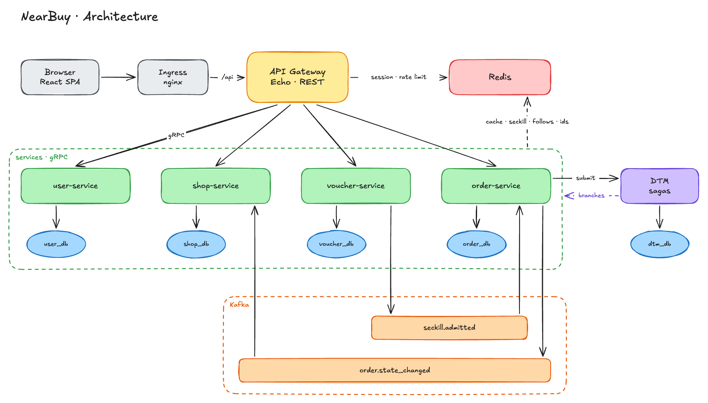
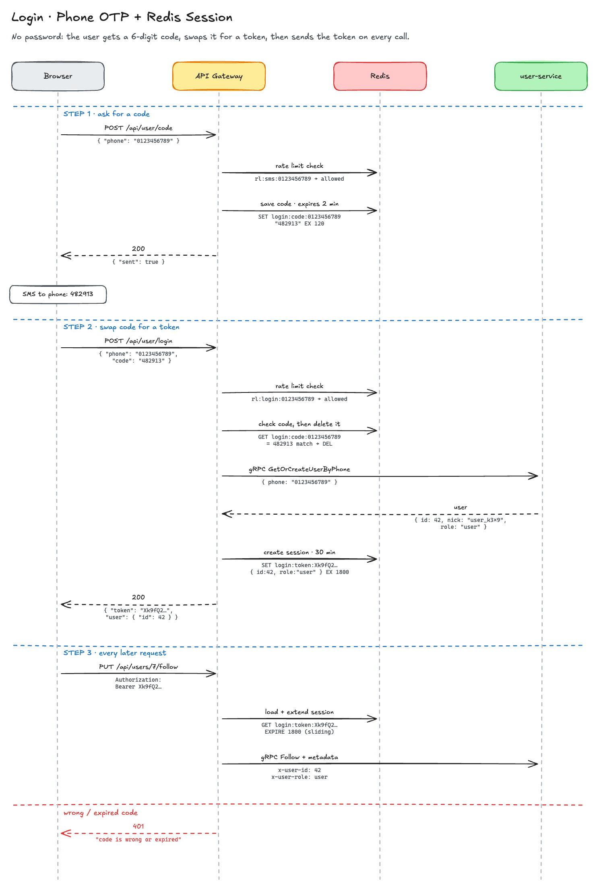
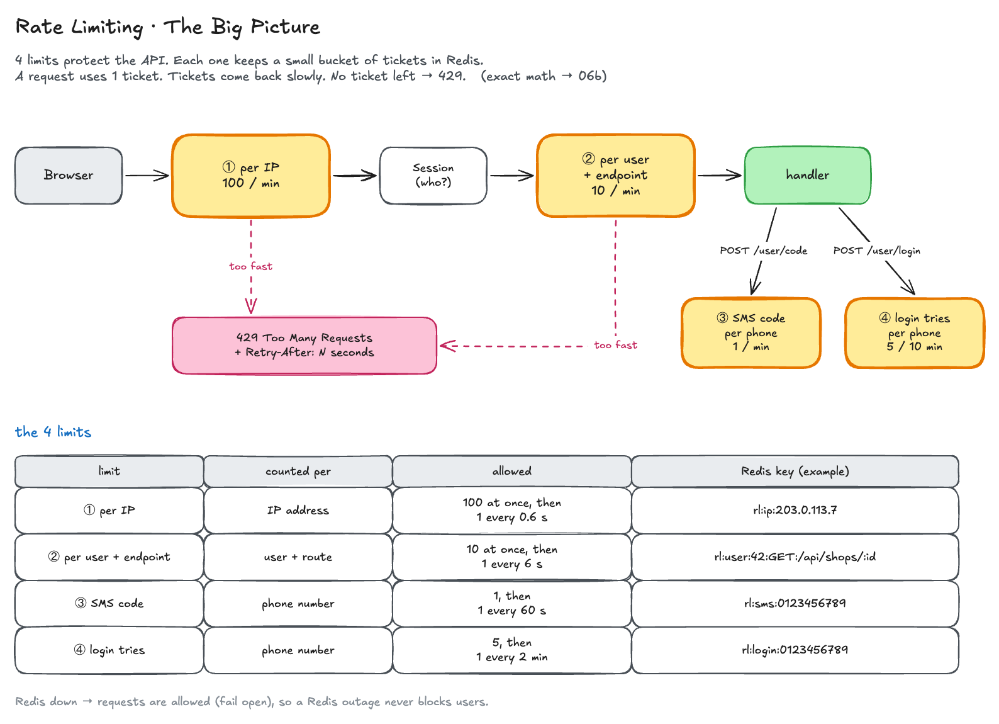
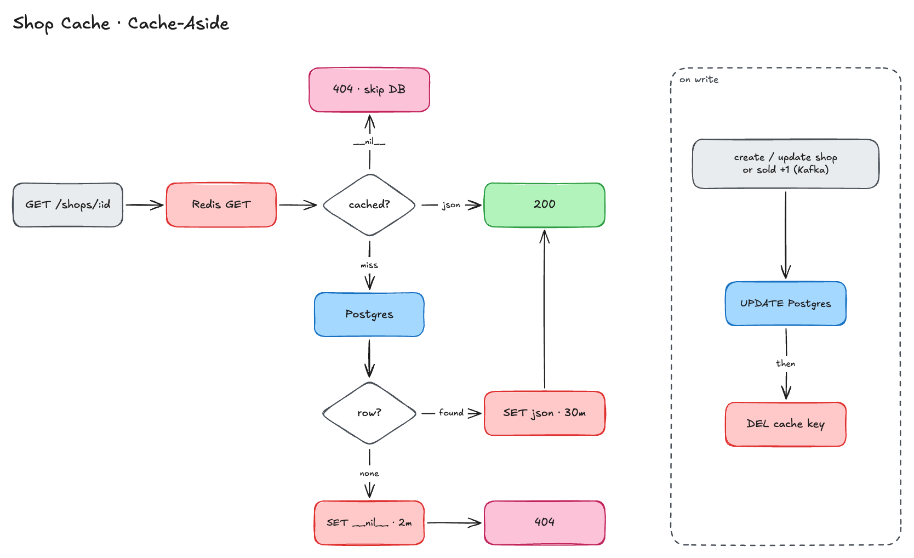
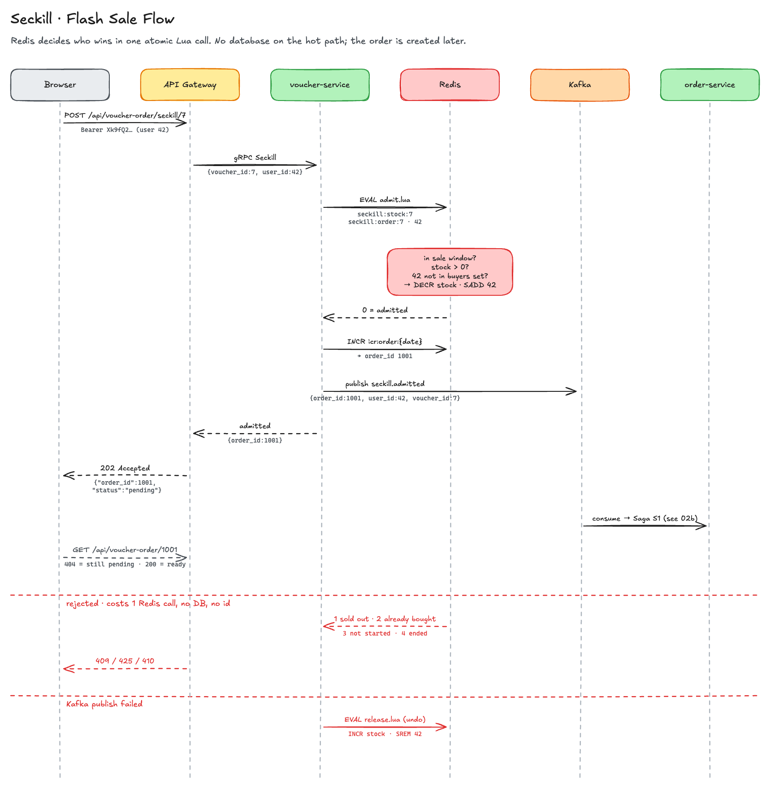
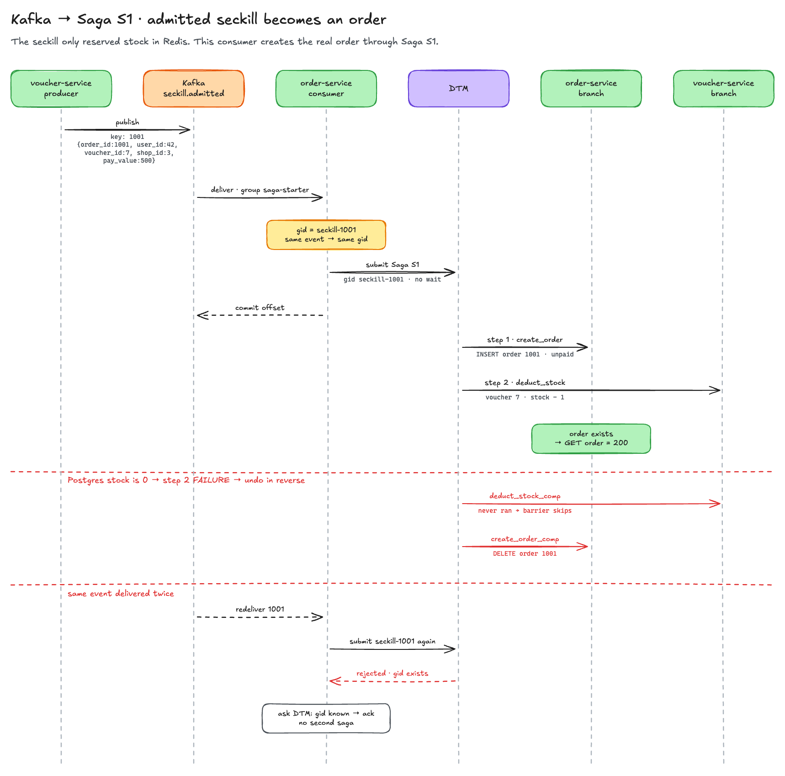
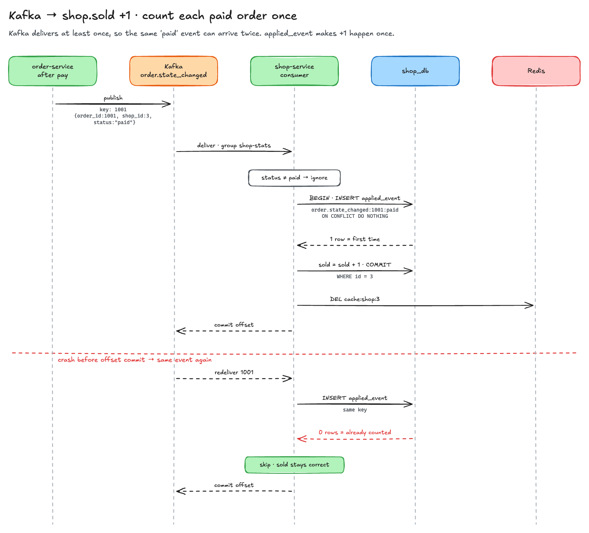
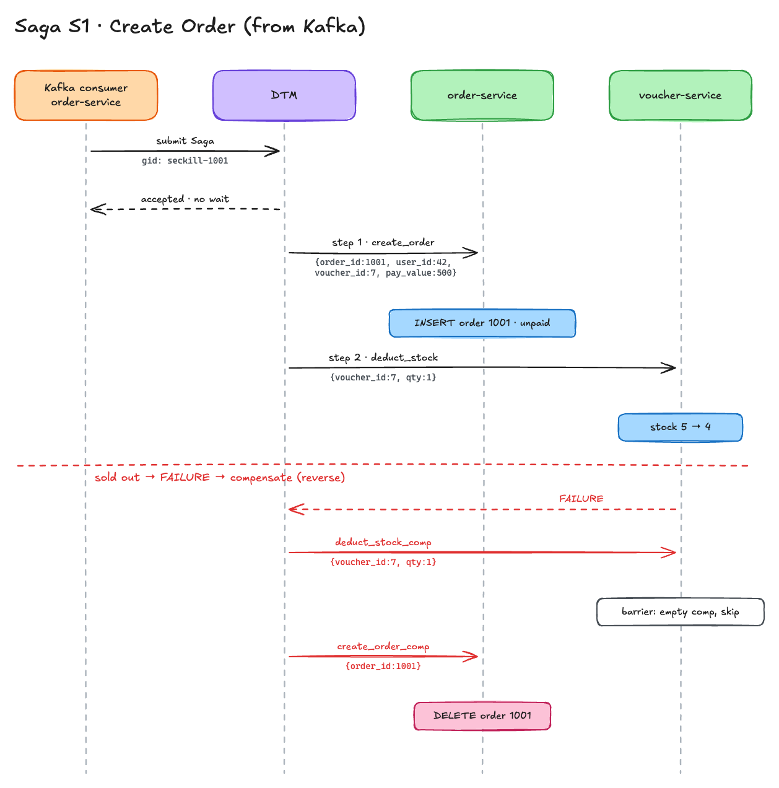
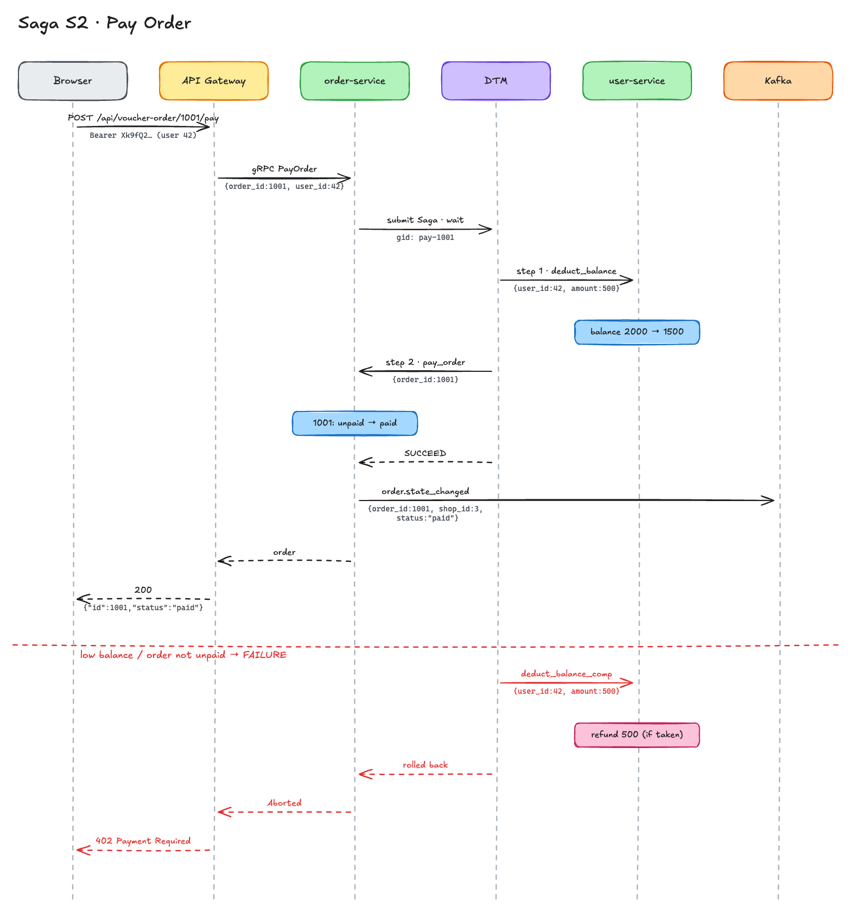
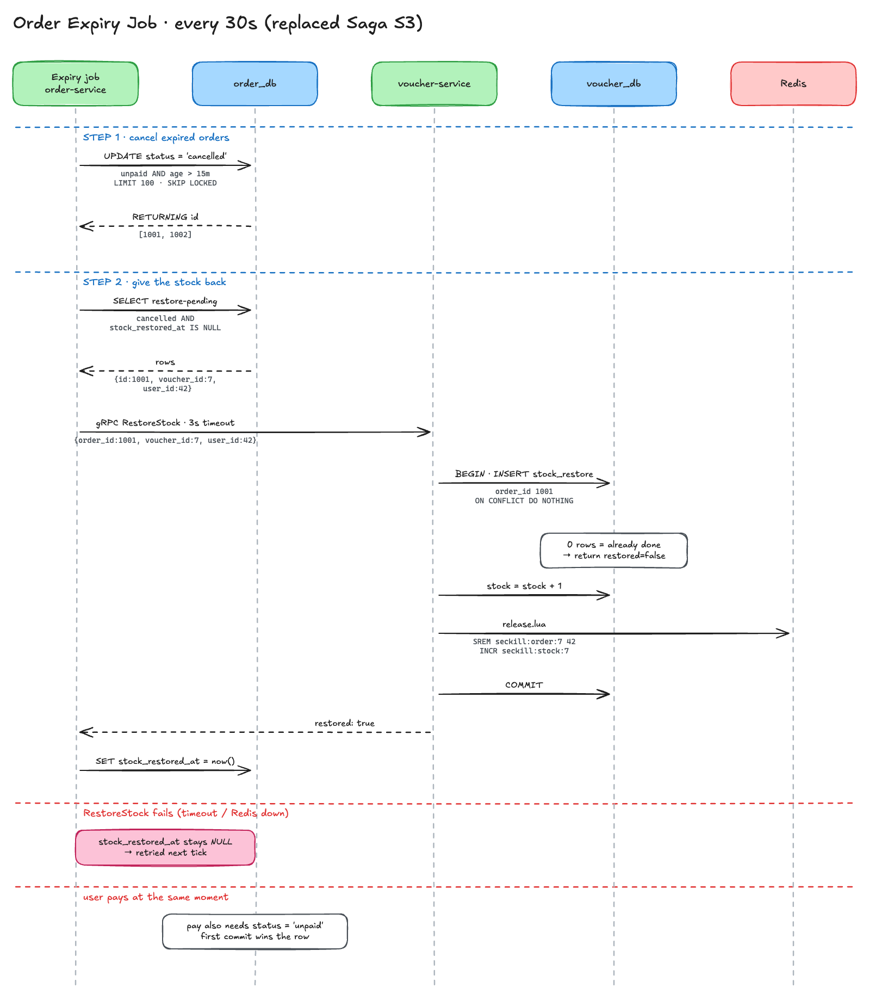

# NearBuy

## Install the tools (one time)
```sh
# Install docker becuase kind runs Kubernetes inside Docker
brew install --cask docker

# Install kind, kubectl and tilt for kubernetes deployment
brew install kind kubectl tilt-dev/tap/tilt

# Install migrate, sqlc, libpq, redis and go
brew install golang-migrate sqlc libpq redis go

# Install protobuf
brew install protobuf
go install google.golang.org/protobuf/cmd/protoc-gen-go@latest
go install google.golang.org/grpc/cmd/protoc-gen-go-grpc@latest

# Install node for the frontend
brew install node
```

## How to Run
```sh
# 1. Create the cluster
make bootstrap
```
-  make cluster: kind create cluster --config ./deploy/kind/cluster-nearbuy.yaml (1 control-plane node and 3 workers)
-  make ingress: install ingress-nginx and wait for the controller ready

```sh
# 2. Start the app
make up

# Press space to open the Tilt UI at http://localhost:10350 and wait for all resources done running
```
- make up: same as tilt up where it starts
	1. config, postgres, redis, kafka
	2. migration for migrate-user/shop/voucher/order/dtm (Run on laptop through the postgres 5432 port-forward)
	3. sqlc to generate repository go code
	4. kafka-topic to create topic
	5. dtm
	6. user, shop, voucher, order services and api-gateway

```sh
# 3. Check the pod
kubectl get pods
```
Output:
```md
NAME                               READY   STATUS
api-gateway-78cd98c8-4thbn         1/1     Running
dtm-68464bd45d-8m2w4               1/1     Running
kafka-0                            1/1     Running
kafka-topics-c2kq5                 0/1     Completed
order-service-6cc8b597c8-rsr9b     1/1     Running
postgres-0                         1/1     Running
redis-7ff748769-wb79j              1/1     Running
shop-service-c574df9b8-82cjb       1/1     Running
user-service-776c9f6f45-lgvqm      1/1     Running
voucher-service-5b95d5c877-4q2dj   1/1     Running
```

```sh
# 4. Test the application working
curl localhost/api/ping
```
Output:
```json
{"message":"pong","pod":"api-gateway-78cd98c8-4thbn"}
```

```sh
# 5. Start the frontend (npm install on first run)
make frontend
# open http://localhost:5173
```

## How to Stop
```sh
make migrate-down # remove all applied migrations from db
make down         # tilt down: removes the app, keeps the cluster
make nuke         # deletes the whole kind cluster
```

## 🌟 Key Features
1. Microservices with gRPC & Database per Service
2. Event-Driven Architecture with Kafka
3. Distributed Transactions with DTM Saga & Barrier
4. Flash Sale with Redis Lua & Async Order Creation
5. Rate Limiting with Token Bucket in Redis
6. Redis Cache-Aside with Cache Penetration Protection
7. SMS Login with Redis Session & Role-Based Access
8. Order Expiry Job (15 mins)
9. Kubernetes Local Setup with kind & Tilt

## 🛠️ Tools
**Backend**: Go, Echo v5, gRPC, Protobuf, pgx v5, sqlc, golang-migrate, go-redis v9, kafka-go, DTM, PostgreSQL 18, Redis 8, Kafka 4.1, Docker, Kubernetes, kind, kubectl, ingress-nginx, Tilt

**Frontend**: React 19, TypeScript, Vite, Material UI, React Router, React Hook Form, Zod, Zustand, Axios, qrcode.react, oxlint

## Architecture
#### Overview


#### Login Session


#### Rate Limit



#### Cache Aside (Shop)


#### FlashSale


#### Kafka
seckill.admitted -> start Saga S1


order.state_changed -> shop.sold + 1 (dedup)


#### Saga
S1 - Create Order


S2 - Pay Order


Order Expiry Job


## More
- [USER_JOURNEY.md](USER_JOURNEY.md): how to use the frontend
- [DOCUMENTATION.md](DOCUMENTATION.md): curl testing, db/redis/kafka check, saga demo, API schema
