# User Journey

```sh
make up        # backend
make frontend  # http://localhost:5173
```

Test users (all login with SMS code, dev mode will fill in the code for you)

| Name          | Phone       | Role  | Balance  |
| ------------- | ----------- | ----- | -------- |
| Ahmad Faizal  | 0123456789  | user  | RM 1,000 |
| Tan Mei Ling  | 0198765432  | user  | RM 1,000 |
| Ravi Kumar    | 01123456780 | user  | RM 0     |
| NearBuy Admin | 0100000000  | admin | RM 0     |

## 1. Explore (no login)
- Filter by category, or search shop name at the top
- Click a shop to see detail and voucher
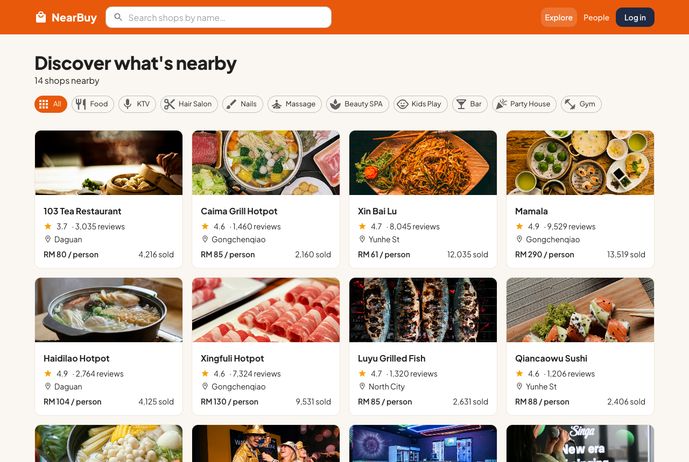

## 2. Login
- Key in phone -> Send code -> Log in
- New phone number will create new account
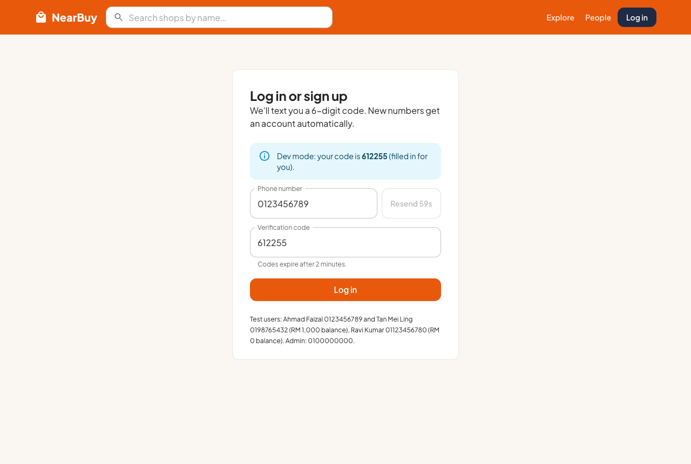

## 3. Admin - Add a flash sale voucher
- Login as 0100000000, nav bar turn dark with ADMIN tag
- Open a shop to edit it, or "Open a shop" to create new one
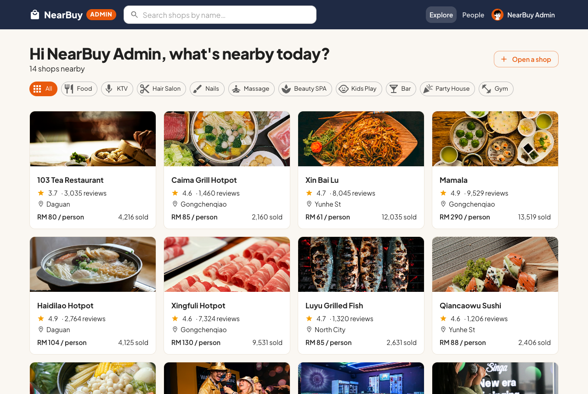

- Shop detail -> Add voucher -> Flash sale (seckill)
- Set price, face value, stock, sale start/end
- Default sale start is 1 minute later
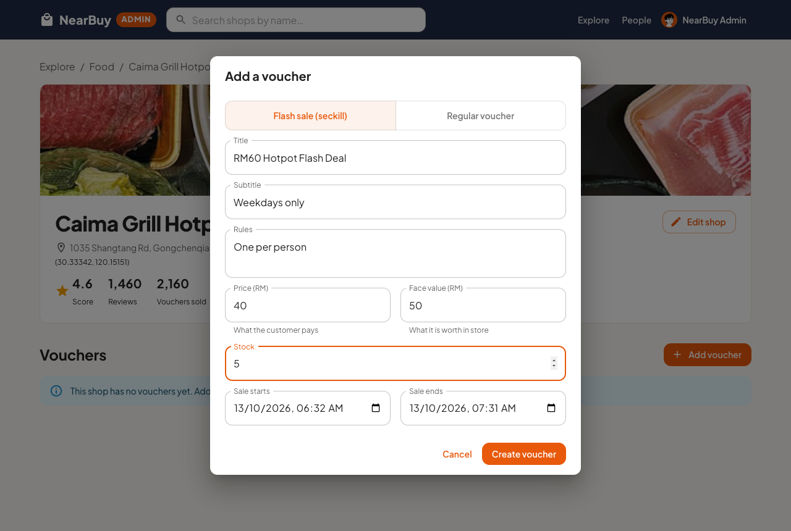

- Voucher show countdown until sale start
- Admin cannot buy
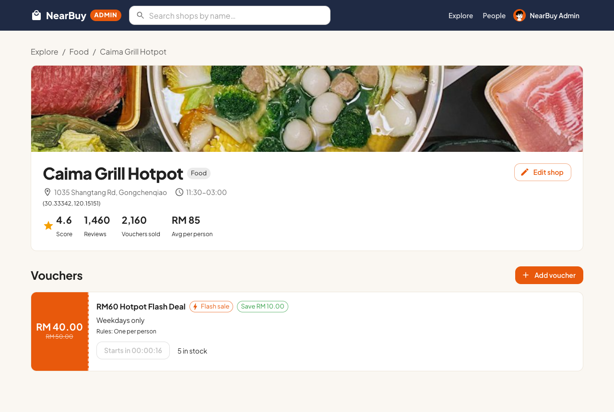

## 4. Customer - Grab the voucher
- Login as Tan Mei Ling 0198765432, open the same shop
- Before sale start, button disabled with countdown
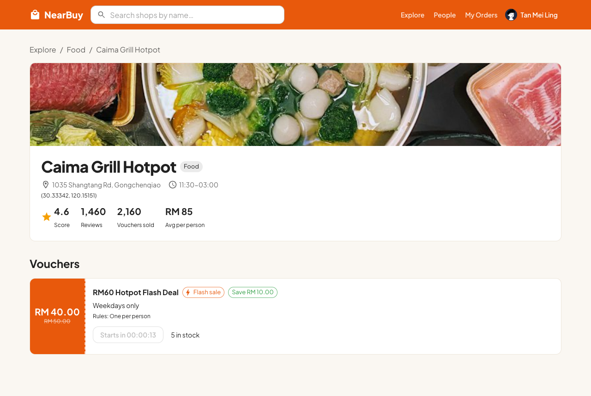

- Sale start -> Grab now
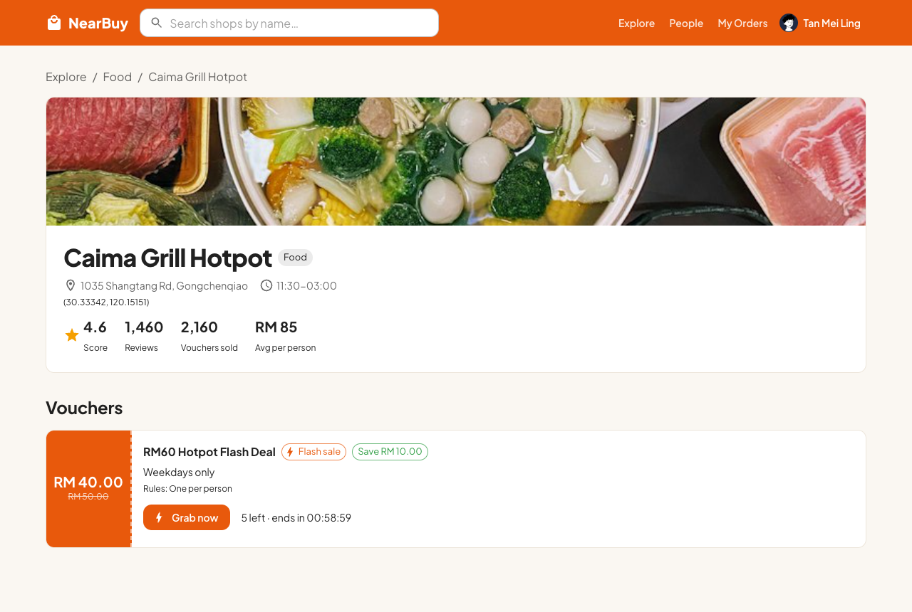

## 5. Customer - Pay
- After grab, go to order detail, status UNPAID
- Pay within 15 minutes, or order cancel and the voucher go back on sale
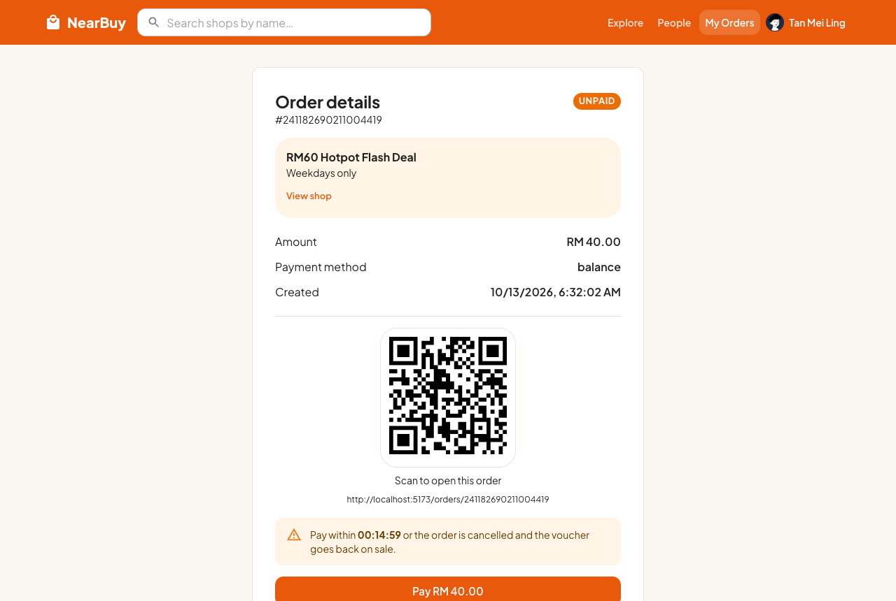

- Pay -> choose NearBuy Balance (others coming soon) -> Pay
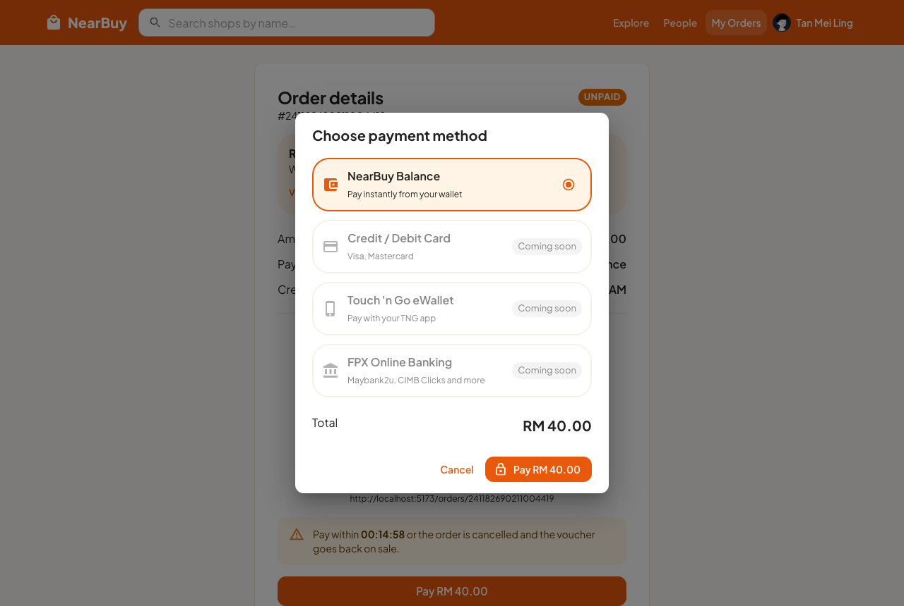

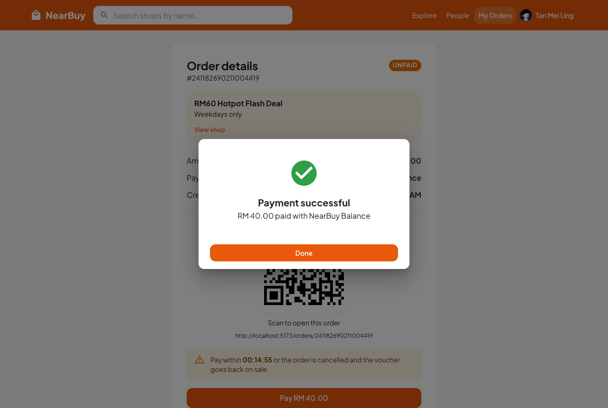

- Order become PAID, show the QR at the shop to redeem
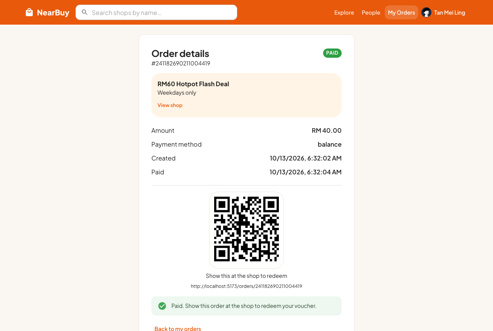

## 6. Customer - My Orders
- Filter by All / Unpaid / Paid / Cancelled
- Cancelled one is the expired order (not paid in 15 mins)
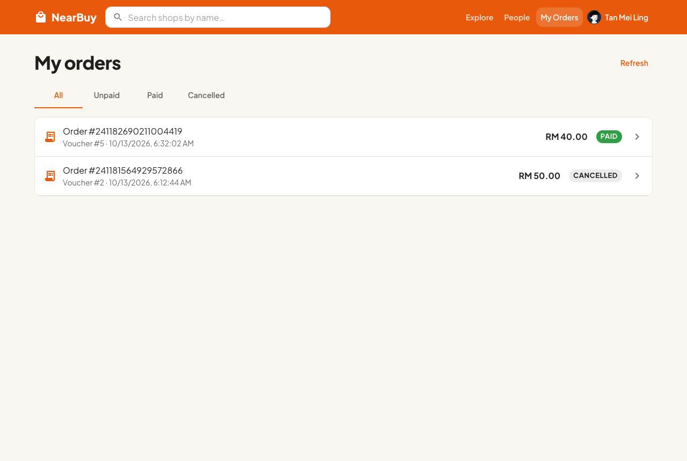

## 7. People - Follow
- People -> key in user id or click seeded user
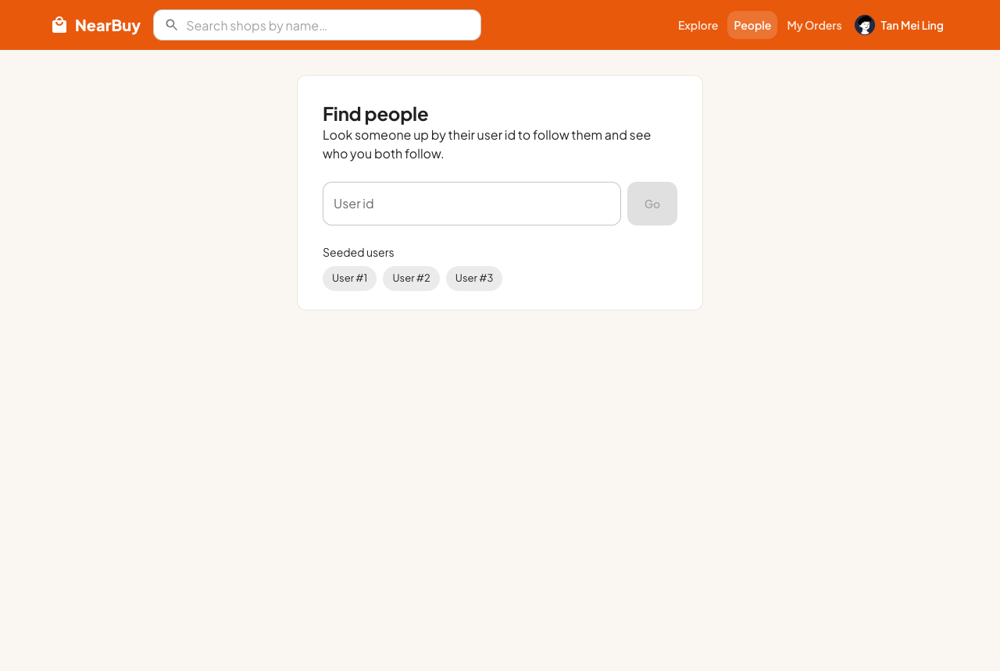

- Follow / Unfollow, follower and following count
- "You both follow" show the common following
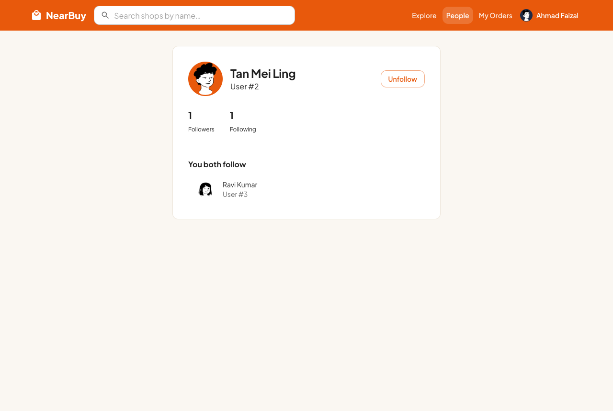
